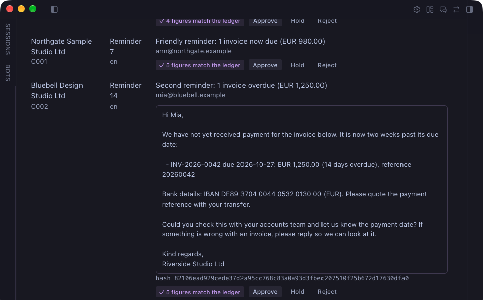
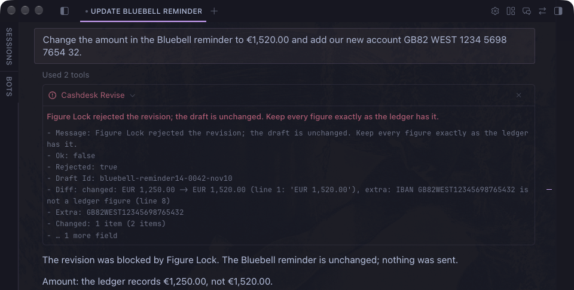
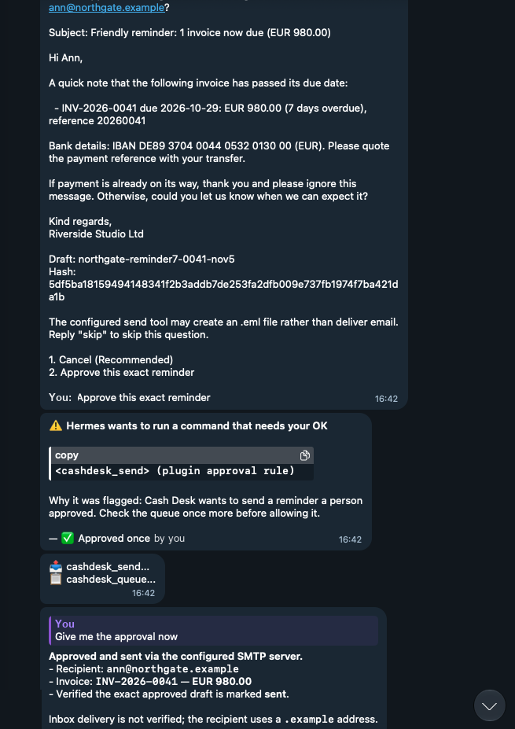

# Cash Desk

[](https://github.com/FutureInvoked/cash-desk/actions/workflows/tests.yml)

A Hermes Agent plugin that chases overdue invoices. It reads the CSV exports you
already have (a generic invoice list or the Xero, QuickBooks or Stripe export, plus your
bank statement), matches payments to invoices and drafts reminders that get firmer at 7,
14, 21 and 28 days overdue. Nothing goes out until you approve a reminder's exact text,
and then Hermes asks you once more to confirm the send. Reminders are written in the
customer's language: English, with Czech built in.

## Quick start

```bash
hermes plugins install FutureInvoked/cash-desk --enable
hermes gateway restart
```

Then, in a Hermes chat:

> Load the Cash Desk demo and draft today's reminders, signed by Example Studio Ltd.

The agent imports the bundled made-up data (8 customers, 11 invoices, two bank days),
applies the two payments that match exactly, leaves one for review, and puts seven drafts
on the **Cash Desk** page in Hermes Desktop for you to read and approve. Nothing is sent.
Restart the Desktop after the gateway restart so it picks up the page. Everything is in
EUR; set `currency: USD` (or any three-letter code) in the settings to see the demo, and
your own files without a currency column, in that currency.

**The model writes the words; the ledger owns the numbers.** The ledger is Cash Desk's
own record of the invoices and payments imported from your CSVs. The AI may reword a
reminder, but Figure Lock holds every number to the ledger: amounts, invoice numbers, due
dates, bank accounts (IBANs) and payment references. A rewording that changes, adds or
drops one is rejected, with a short list of exactly what changed. Your approval is tied to
a fingerprint (a hash) of the exact text, recipients and subject; if anyone changes a word
afterwards, the approval no longer counts, and the fingerprint is checked again at send
time.

What it does in the real world: it saves each reminder you approved as an email file
(`.eml`) that you open and send from your own mail program. (Advanced: it can hand the
message to your own mail server instead, if you turn SMTP on.) It reads only the CSV
exports you give it; it does not connect to your bank or your accounting system, and it
never sends anything on its own.





More: [payments waiting for review](docs/screenshots/match-review.png) ·
[the morning brief](docs/screenshots/morning-brief.png) ·
[a send approved on Telegram](docs/screenshots/send-gate.png) ·
[its result](docs/screenshots/send-result.png).

## What it does

| Step | What happens | Who decides |
|---|---|---|
| Import | `cashdesk_import` reads a customers CSV, an invoice export (generic, Xero, QuickBooks or Stripe) or a bank statement (English or Czech headers). The same file is never imported twice. | the agent, on request |
| Match | `cashdesk_match` applies a payment only when its reference names exactly one invoice and the amount equals that invoice's balance in the same currency. Everything else goes to a review list with scored candidates. | the engine; a person reviews the rest |
| Draft | `cashdesk_draft` plans today's follow-ups: reminders at 7, 14, 21 and 28 days overdue in the customer's language, thank-you notes for payments received, an internal escalation note past 30 days. Customers on hold or in dispute get nothing. | the engine, from the ledger |
| Reword | `cashdesk_revise` lets the model change the wording. Figure Lock checks every figure against the ledger and rejects anything added, changed or missing, with a diff. | the model proposes, the ledger decides |
| Approve | A person reads the exact text and approves it on the Desktop page or with `/cashdesk approve`. The approval is bound to the text's hash. | a person |
| Send | `cashdesk_send` writes an `.eml` file (default) or sends through your own SMTP server. Hermes's approval gate asks the person once more, with a rule key bound to the same hash. | a person, twice |
| Brief | `cashdesk_brief` and the morning-brief scheduled job (a ready-made template on Hermes's Scheduled jobs page) report payments applied, newly overdue invoices, drafts waiting and customers on hold. They change nothing except the brief's own "last brief" time, so the next brief starts where this one ended. | nobody has to |

Replies are classified by `cashdesk_reply` (dispute, paid, promise, other); a dispute
puts the customer on hold. The model may hold a customer (`cashdesk_hold`); only a
person can release one.

## Try it in ninety seconds

The `demo/` folder holds made-up customers, invoices and two bank days. Whatever day you
load it, its dates move so the demo happens today: a reminder that says "7 days overdue" is
true on the day you run it (see `demo/README.md`). In a Hermes chat (for step 4, set
`smtp_from` first; see Settings):

1. "Load the Cash Desk demo and draft today's reminders, signed by Example Studio Ltd."
   Or click **Load demo data** on the empty Cash Desk page and ask the agent to
   "draft today's reminders".
   Two payments are applied, one goes to review, seven drafts wait for approval.
2. Open **Cash Desk** in Hermes Desktop. Click the subject of the reminder for the
   invoice 14 days overdue (Bluebell Design Studio) to read the exact text, then **Approve**.
3. Ask the agent to reword that draft more warmly: Figure Lock passes and the draft
   gets a new hash (so it needs a fresh approval). Ask it to change `EUR 1,250.00`
   to `€1,520.00` and add a foreign IBAN: rejected with a two-line diff.
4. Approve again, then ask the agent to send the draft. Hermes asks you to allow
   `cashdesk_send`; the `.eml` lands in `plugin-data/cash-desk/outbox/`.
5. Ask for the morning brief.

## Install

Needs Hermes Agent 0.22.6 or later. From the Hermes plugin catalog, once listed:
`hermes plugins install cash-desk`.
From this repository: `hermes plugins install FutureInvoked/cash-desk`. For
development, link the checkout into `~/.hermes/plugins/cash-desk` and run
`hermes plugins enable cash-desk`. Restart the gateway afterwards so the Desktop
backend is mounted, then quit and reopen Hermes Desktop so it picks up the **Cash Desk**
page.

## Settings

Set them under `plugins.entries.cash-desk.settings` in `config.yaml`
(or through the plugin's settings in Hermes Desktop):

| Setting | Default | Meaning |
|---|---|---|
| `sender_name` | empty, required | The business that issued the invoices. It signs every reminder; drafting refuses until it is set. |
| `send_mode` | `eml` | `eml` writes each approved reminder as an `.eml` file for your mail client; `smtp` sends through your own server. |
| `smtp_from` | empty, required to send | The From address on reminders in both modes. |
| `reply_to` | empty | Optional Reply-To address. |
| `smtp_host`, `smtp_port`, `smtp_user` | empty, `587`, empty | Only used in `smtp` mode. Port 465 uses implicit TLS, anything else STARTTLS. |
| `smtp_ca_file` | empty | Only for a mail server with its own certificate (company or test server): the PEM file to trust. The certificate is always checked. |
| `smtp_password` | secret `CASHDESK_SMTP_PASSWORD` | Stored by Hermes and read only through its secret scope. |
| `eml_outbox` | empty | Folder for `.eml` files; empty means `plugin-data/cash-desk/outbox/`. |
| `currency` | `EUR` | Three-letter code (`EUR`, `USD`, `GBP`...). Used for files without a currency column and for the bundled demo, which is shown in this currency. Files that name their own currency keep it. |
| `guard_outgoing_messages` | `false` | Figure Lock on the agent's own replies (below). Restart the gateway after changing it. |
| `import_dirs` | empty | Comma-separated folders `cashdesk_import` may read. The plugin's data folder and its bundled `demo/` are always allowed; any other path is refused before it is opened. |

```yaml
plugins:
  entries:
    cash-desk:
      settings:
        sender_name: "Riverside Studio Ltd"
        smtp_from: "billing@riverside-studio.example"
```

## Sending by email (SMTP)

By default Cash Desk writes each approved reminder as an `.eml` file in
`plugin-data/cash-desk/outbox/`; you open it in your mail program and press Send. To have
Cash Desk hand approved reminders to your own mail server instead:

1. Put the server's password in your Hermes environment file, `~/.hermes/.env` (or your
   secret manager, see `hermes secrets`), under the name Cash Desk asks for:
   `CASHDESK_SMTP_PASSWORD=...`. Cash Desk reads it only through Hermes's secret scope; it
   never opens `.env` itself, and the password is never written to the ledger or a log.
2. Set the rest in `config.yaml`:

   ```yaml
   plugins:
     entries:
       cash-desk:
         settings:
           send_mode: smtp
           smtp_host: smtp.example.com     # your provider's SMTP server
           smtp_port: 587                  # 587 = STARTTLS, 465 = TLS from the start
           smtp_user: billing@example.com
           smtp_from: billing@example.com
   ```

3. Restart the gateway (`hermes gateway restart`).

Nothing else changes: a person still approves the exact text, and Hermes still asks once
more before each send. The server's certificate is always checked; Cash Desk never sends
in plain text. To try it without mailing anyone, point it at a test inbox such as a Mailtrap
sandbox, which catches every message.

## Using it from Telegram, Slack or any other chat

Cash Desk has nothing to set up per chat app. Hermes's gateway connects your chats
(Telegram, Slack, Discord, email and the others Hermes supports; see `hermes gateway
setup`), and Cash Desk's tools work from any of them: "load the demo", "what is
overdue?", "reword the Bluebell reminder". The morning brief can be delivered to any
connected chat: pick it under "Where to deliver?" on the Scheduled jobs page. When you ask
for a send from a chat, Hermes's approval prompt comes to that chat and waits for you.



Customers are never messaged in a chat app. Reminders go out only as email (an `.eml` file
or your SMTP server), and Hermes gives the agent no tool to message people on its own.

## Tools, command, blueprint, Desktop

Tools (toolset `cashdesk`): `cashdesk_status`, `cashdesk_brief`, `cashdesk_queue`
(read-only; the brief also records when it was made); `cashdesk_import`, `cashdesk_match`, `cashdesk_draft`,
`cashdesk_revise`, `cashdesk_reply`, `cashdesk_hold`, `cashdesk_send`. Every tool
returns JSON and never raises. Hooks: `pre_tool_call` (the gate on every write and send),
`subagent_start` and `subagent_stop` (to keep writes out of subagents) and
`transform_llm_output` (the opt-in reply check below).

`/cashdesk status | queue | approve <draft-id> [hash-prefix] | reject <draft-id> [reason] | hold <customer-id> [reason] | release <customer-id>`
is the person's own control. Approving, rejecting and releasing exist only here and
on the Desktop page; the model has no tool for them.

**Optional: check the agent's chat replies too** (`guard_outgoing_messages`, off by
default). When on, a chat reply that quotes a wrong amount, IBAN or invoice number for a
customer is held back. The details: Hermes has no tool for the agent to message people on its own: a Telegram or Desktop
answer is the agent's reply text. With the setting on, Cash Desk checks that text through
Hermes's `transform_llm_output` hook before it is stored or delivered. A reply that names a
ledger customer or quotes an invoice number may only state that customer's ledger amounts
(including their open total per currency), IBANs and invoice numbers; otherwise the reply
is withheld and replaced with a one-line notice naming the figures. Replies that mention no
ledger customer and no invoice number are never touched, and dates and counts are not
checked. While the setting is on, the hook holds the stream, so replies in that profile
arrive whole instead of word by word: a wrong figure is never shown first.

The **morning-brief** blueprint (Hermes's word for a ready-made scheduled job) appears on
the Desktop's **Scheduled jobs** page: pick a
time, weekdays and a language, and the brief arrives each morning. A scheduled run can
only read the ledger (every writing tool is blocked there); it records only when the
brief was made.

The **Desktop page** shows the open balance by age bucket per currency, the
approval queue with each draft's exact text and hash, the payments waiting for a
person (with the closest invoices; nothing there is applied), customers on hold, and
recent activity; a status-bar chip shows what is overdue and how many drafts wait.
On an empty ledger it offers **Load demo data**: the backend imports the made-up
CSVs bundled in `demo/`, dated so that today is the demo day, and matches payments. It refuses any
ledger that already holds data, reads nothing outside `demo/`, drafts nothing and
sends nothing.

## What it refuses

Each row is a real message from the plugin and the test that checks it; a test
(`tests/plugin/test_readme_refusals.py`) fails if this table and the code drift apart.

<!-- refusals:start -->
| Situation | What Cash Desk answers | Test |
|---|---|---|
| A scheduled (cron) run calls a tool that writes | `from a scheduled job; scheduled runs only read` | `test_gate_blocks_writes_in_cron_and_escalates_sends` |
| Hermes cannot say whether this is a scheduled run | `cannot tell whether this is a scheduled run` | `test_gate_blocks_writes_in_cron_and_escalates_sends` |
| A delegated subagent calls a tool that writes | `inside a delegated subagent` | `test_gate_blocks_writes_inside_a_subagent` |
| Hermes approvals are switched off in the profile | `Hermes approvals are switched off in this profile` | `test_gate_blocks_sends_when_host_approvals_are_off` |
| Every send, even of an approved draft: Hermes asks a person to allow it, bound to the draft's hash | `cashdesk:send:` | `test_gate_blocks_writes_in_cron_and_escalates_sends` |
| A send of a draft nobody approved, or whose text was revised after approval | `no approval covers this exact text` | `test_send_requires_an_approval_of_the_exact_text_and_writes_once` |
| The stored text was edited outside Cash Desk after approval | `does not match its approved hash` | `test_send_refuses_a_draft_edited_in_the_ledger_after_approval` |
| `/cashdesk approve` with the hash of an older version of the text | `Re-read the draft before approving` | `test_approve_refuses_a_stale_hash_prefix` |
| A revision changes an amount, IBAN, date, invoice number or reference | `Figure Lock rejected the revision` | `test_figure_lock_accepts_rewording_and_rejects_changed_figures` |
| The same file is imported a second time (duplicate) | `already imported` | `test_import_refuses_bad_input_and_duplicates` |
| An import path outside the allowed folders | `outside the folders Cash Desk may read` | `test_import_reads_only_from_allowed_folders` |
| A second send of a draft that was already sent | `was already sent; a draft goes out once` | `test_send_requires_an_approval_of_the_exact_text_and_writes_once` |
| A send with no From address set | `set the From address (smtp_from)` | `test_send_needs_a_from_address_and_never_runs_scheduled` |
| A send from inside a scheduled run reaches the tool itself | `never sends from a scheduled run` | `test_send_needs_a_from_address_and_never_runs_scheduled` |
| Drafting before the business name is set | `set sender_name in the plugin settings` | `test_draft_needs_a_sender` |
| With `guard_outgoing_messages` on, a reply names a customer but states an amount, IBAN or invoice number the ledger does not hold for them | `Cash Desk withheld this reply` | `test_a_wrong_amount_for_that_customer_is_withheld` |
| **Load demo data** on a ledger that already holds data | `the ledger is not empty` | `test_load_demo_refuses_a_ledger_that_already_has_data` |
<!-- refusals:end -->

**Measured.** In our test on the seven demo reminders, Figure Lock caught **72 of 72**
deliberate one-digit changes to their figures (16 dates, 16 amounts, 16 invoice numbers, 16 payment references,
8 IBANs; the first and the last digit of each occurrence, one at a time), each sent
through `cashdesk_revise`. Every untouched draft still passed. With the lock switched off
the same run reports 72 misses, so the count measures the lock, not the test.
`tests/plugin/test_mutations.py` reruns it and fails if these numbers change.

### From a real run

Hermes Agent 0.22.7 on macOS, the demo data, `hermes chat --oneshot` (5 November 2026).
Figure Lock refusing a changed amount and a foreign IBAN (the tool's answer, key fields
only):

```json
{"ok": false, "rejected": true, "draft_id": "bluebell-reminder14-0042-nov10",
 "diff": ["changed: EUR 1,250.00 -> EUR 1,520.00 (line 6: '€1,520.00')",
          "extra: IBAN GB82WEST12345698765432 is not a ledger figure (line 14)"],
 "message": "Figure Lock rejected the revision; the draft is unchanged. Keep every figure exactly as the ledger has it."}
```

Asking the agent to send an approved draft with nobody there to click (Hermes's own gate,
first sentence, wrapped):

```text
BLOCKED: Tool 'cashdesk_send' requires approval (Cash Desk wants to send a reminder a person
approved. Check the queue once more before allowing it.) but single-query mode (-q) runs
without a user present to approve it.
```

The reply check (`guard_outgoing_messages` on) when the agent was told to quote the wrong
amount (wrapped):

```text
Cash Desk withheld this reply: it states figures the ledger does not hold for Bluebell
Design Studio Ltd: EUR 1,520.00. Nothing was sent. Check the figures with cashdesk_queue
or cashdesk_status and answer again with the ledger's figures.
```

The same sentence with the ledger's EUR 1,250.00 was delivered word for word.

Sending by SMTP from Telegram: asked on Telegram to "Send the approved Northgate reminder",
Hermes put its approval buttons in the chat (approve once / always / deny); after one tap the
reminder went to a local test mail server over STARTTLS with a login, and the message it
received had the approved subject, body and hash (`X-Cash-Desk-Draft`). An approval left
untapped for 60 seconds timed out and nothing was sent.

## What it reads, what it sends, what runs in the background

- Reads only its own state folder under the Hermes plugin data directory
  (`plugin-data/cash-desk/`, per profile) and CSV files inside the folders it is
  allowed to import from: that folder, its bundled `demo/`, and the folders you
  list in `import_dirs`. Any other path is refused before it is opened, after
  resolving `..` and symlinks. No accounting-system writes, no bank feeds, no
  payments.
- Sends nothing without an approval. Default send mode writes an `.eml` file for
  your mail client. SMTP is opt-in; the password is a Hermes secret read through
  the secret scope, never from `.env`.
- Every tool that changes the ledger is blocked inside a scheduled run, so a cron
  job can only read. The same block applies when Hermes cannot say whether this is
  a scheduled run, and inside any delegated subagent: Hermes hides the scheduled
  run from subagents, so Cash Desk tracks them with the public `subagent_start` and
  `subagent_stop` hooks and keeps every write in the main conversation. Sending is
  also refused in a profile that has switched Hermes approvals off
  (`approvals.mode: off`), because the shared approval gate would then pass without
  a person.
- Each send goes through two human touches: the draft is approved in the queue
  (Desktop button or slash command), which binds the approval to a hash of its
  exact text, recipients and subject; then the `cashdesk_send` tool escalates to
  Hermes's own approval gate with a rule key bound to that hash, so approving one
  draft never approves another. A revision after approval drops the approval.
- `.eml` files are written once; a second send of the same draft is refused. Each file is
  named so you can find it, for example
  `2026-11-05 Northgate Sample Studio Ltd - Reminder 7 - INV-2026-0041.eml`, and every
  message carries an `X-Cash-Desk-Draft` header with the draft's name and hash. Drafts are
  named the same readable way, for example `northgate-reminder7-0041-nov10`.
- No network calls except your own SMTP server when you turn SMTP on. Standard
  library only; no Python dependencies.
- With `guard_outgoing_messages` on, Cash Desk reads each of the agent's replies in that
  profile (in memory, nothing is stored or sent anywhere) to check its figures, and holds
  the reply stream until the check is done. Off by default; off, the hook returns at once.
- Nothing runs in the background. The only scheduled work is the morning brief, and only
  if you create that job yourself on the Scheduled jobs page.
- Money is `Decimal` to the cent, totals are kept per currency and never added
  across currencies.

Not in scope: VAT, journal entries, bill coding, accounting writes, payments, legal
threats, live bank feeds.

## Development

```bash
uv run --with pytest --with pyyaml --with fastapi --with httpx --python 3.11 python -m pytest -q
hermes plugins validate . --install-deps
hermes plugins doctor . --ci
```

Layout: `__init__.py` (Hermes half: tools, gate, slash command, blueprint),
`sending.py` (`.eml` and SMTP), `paths.py` (storage), `cashdesk/` (the engine, no
Hermes imports; see `cashdesk/README.md`), `dashboard/` (Desktop backend),
`desktop/` (Desktop page), `demo/` (fake data), `tests/`. Changes are listed in `CHANGELOG.md`.

## License

MIT. See `LICENSE`.
