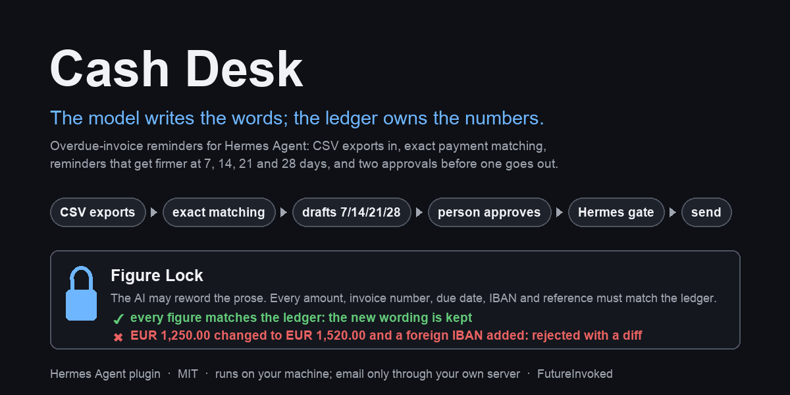

# Cash Desk



[](https://github.com/FutureInvoked/cash-desk/actions/workflows/tests.yml)

A Hermes Agent plugin that chases overdue invoices. It reads the CSV exports you
already have (a generic invoice list or the Xero, QuickBooks or Stripe export, plus your
bank statement), matches payments to invoices and drafts reminders that get firmer at 7,
14, 21 and 28 days overdue. Nothing goes out until you approve a reminder's exact text,
and then Hermes asks you once more to confirm the send. Reminders are in English unless
you choose another language, for everyone (`default_language`) or per customer.

## Quick start

```bash
hermes plugins install FutureInvoked/cash-desk --enable
hermes gateway restart
```

Then, in a Hermes chat:

> Load the Cash Desk demo and draft today's reminders, signed by Example Studio Ltd.

The agent imports the bundled made-up data (8 customers, 11 invoices, two bank days),
applies the two payments that match exactly, leaves one for review, and puts six drafts
on the **Cash Desk** page in Hermes Desktop for you to read and approve. Nothing is sent.
Restart the Desktop after the gateway restart so it picks up the page. Everything is in
EUR; set `currency: USD` (or any three-letter code) in the settings to see the demo, and
your own files without a currency column, in that currency.

**The model writes the words; the ledger owns the numbers.** The ledger is Cash Desk's own
record of the invoices and payments in your CSVs. The AI may make a reminder warmer or firmer,
but Figure Lock refuses any change to an amount, invoice number, due date, IBAN or reference,
and added wording from a list of known payee, deadline, fee and threat phrases (a list, not a
guarantee: you still read the text before approving). Your approval is tied to the exact text: if a word
changes afterwards, the approval no longer counts.

What it does in the real world: it saves each reminder you approved as an email file
(`.eml`) that you open and send from your own mail program. (Advanced: it can hand the
message to your own mail server instead, if you turn SMTP on.) It reads only the CSV
exports you give it; it does not connect to your bank or your accounting system, and it
never sends anything on its own.


More: [payments waiting for review](docs/screenshots/match-review.png) ·
[the morning brief](docs/screenshots/morning-brief.png) ·
[a send approved on Telegram](docs/screenshots/send-gate.png) ·
[its result](docs/screenshots/send-result.png).

## What it does

| Step | What happens | Who decides |
|---|---|---|
| Import | `cashdesk_import` reads a customers CSV, an invoice export (a generic list, Xero, QuickBooks Online or Stripe, as they really export them) and bank statements from most banks. Only booked bank lines count as money; anything it cannot read for certain (dates that read both ways, an unreadable balance or direction column, conflicting figures) is refused with the reason instead of guessed. The same file is never imported twice, and a newer export never undoes a payment already recorded. Format details: [docs/formats.md](docs/formats.md). | the agent, on request |
| Match | `cashdesk_match` applies a payment only when its reference and amount match one open invoice exactly (or several invoices of one customer, to the cent), in the same currency, from that customer. Everything else waits in a review list where a person clicks **Apply** or **Dismiss**. | the engine; a person places the rest |
| Draft | `cashdesk_draft` writes today's reminders at 7, 14, 21 and 28 days overdue in the customer's language, and thank-you notes for payments received. Customers on hold, in dispute, or with money that may have arrived get nothing. | the engine, from the ledger |
| Reword | `cashdesk_revise` lets the model make the wording warmer or firmer. Figure Lock refuses any change to an amount, invoice number, date, IBAN or reference, and added links or wording from its list of known payee, deadline, fee and threat phrases. You still read the text before approving. | the model proposes, the ledger decides |
| Approve | You read the exact text on the Desktop page or with `/cashdesk show`, and approve it. The approval is tied to that exact text; if anything changes before sending, it no longer counts. | you |
| Send | `cashdesk_send` saves an `.eml` file (or sends through your own mail server). Hermes asks you once more, naming the reminder, customer, recipient and total. Without a person to answer, nothing is sent. | you, twice |
| Brief | `cashdesk_brief` and the morning-brief scheduled job (a ready-made template on Hermes's Scheduled jobs page) report payments applied, newly overdue invoices, drafts waiting and customers on hold. They change nothing except the brief's own "last brief" time, so the next brief starts where this one ended. | nobody has to |

Replies go through `cashdesk_reply`: the model reads the customer's answer and records it as
dispute, paid, promise or other (a keyword list is only the fallback). A dispute puts the
customer on hold; a promise to pay by a date pauses their reminders until two days after
it (a promise without a date pauses them for a week); "we already paid" pauses them for five days
while the bank statement catches up, and changes no balance. The
model may hold a customer (`cashdesk_hold`); only a person can release one.

Weekly use, what pauses a reminder and how to resume it: [docs/weekly-use.md](docs/weekly-use.md).

## Try it in ninety seconds

The `demo/` folder holds made-up customers, invoices and two bank days. Whatever day you
load it, its dates move so the demo happens today: a reminder that says "7 days overdue" is
true on the day you run it (see `demo/README.md`). In a Hermes chat (for step 4, set
`smtp_from` first; see Settings):

1. "Load the Cash Desk demo and draft today's reminders, signed by Example Studio Ltd."
   Or click **Load demo data** on the empty Cash Desk page and ask the agent to
   "draft today's reminders".
   Two payments are applied, one goes to review, six drafts wait for approval.
2. Open **Cash Desk** in Hermes Desktop. Click the subject of the reminder for the
   invoice 14 days overdue (Bluebell Design Studio) to read the exact text, then **Approve**.
3. Ask the agent to reword that draft more warmly: Figure Lock passes and the draft
   gets a new hash (so it needs a fresh approval). Ask it to change `EUR 1,250.00`
   to `€1,520.00` and add a foreign IBAN: rejected with a two-line diff.
4. Approve again, then ask the agent to send the draft. Hermes asks you to allow
   `cashdesk_send`; the `.eml` lands in `plugin-data/cash-desk/outbox/`.
5. Ask for the morning brief.

## Install

Needs Hermes Agent 0.22.6 or later. From the Hermes plugin catalog, once listed:
`hermes plugins install cash-desk`.
From this repository: `hermes plugins install FutureInvoked/cash-desk`. For
development, link the checkout into `~/.hermes/plugins/cash-desk` and run
`hermes plugins enable cash-desk`. Restart the gateway afterwards so the Desktop
backend is mounted, then quit and reopen Hermes Desktop so it picks up the **Cash Desk**
page.

## Settings

Set them under `plugins.entries.cash-desk.settings` in `config.yaml`
(or through the plugin's settings in Hermes Desktop):

| Setting | Default | Meaning |
|---|---|---|
| `sender_name` | empty, required | The business that issued the invoices. It signs every reminder; drafting refuses until it is set. |
| `default_language` | `en` | `en` or `cs`: the language for customers imported from files with no language column (Xero, QuickBooks and Stripe exports have none). A language column always wins. |
| `payment_iban` | empty | Your bank account. Reminders for invoices whose export carries no IBAN (Xero, QuickBooks and Stripe usually do not) print it, and Figure Lock holds it like any ledger figure. Must be a valid IBAN. |
| `send_mode` | `eml` | `eml` writes each approved reminder as an `.eml` file for your mail client; `smtp` sends through your own server. |
| `smtp_from` | empty, required to send | The From address on reminders in both modes. |
| `reply_to` | empty | Optional Reply-To address. |
| `smtp_host`, `smtp_port`, `smtp_user` | empty, `587`, empty | Only used in `smtp` mode. Port 465 uses implicit TLS, anything else STARTTLS. |
| `smtp_ca_file` | empty | Only for a mail server with its own certificate (company or test server): the PEM file to trust. The certificate is always checked. |
| `smtp_password` | secret `CASHDESK_SMTP_PASSWORD` | Stored by Hermes and read only through its secret scope. |
| `eml_outbox` | empty | Folder for `.eml` files; empty means `plugin-data/cash-desk/outbox/`. |
| `currency` | `EUR` | Three-letter code (`EUR`, `USD`, `GBP`...). Used for files without a currency column and for the bundled demo, which is shown in this currency. Files that name their own currency keep it. |
| `date_order` | `auto` | How to read slashed dates: `auto` decides from each file and refuses a file whose dates all read both ways; `dmy` (05/11/2026 = 5 November) or `mdy` (= May 11) sets it once for your bank and accounting files. |
| `ignore_balances_below` | `10.00` | An open balance under this (a bank fee, rounding) gets no automatic reminder; it is listed as held so you can write it off or chase it by hand. `0` chases everything. |
| `guard_outgoing_messages` | `false` | Figure Lock on the agent's own replies (below). Restart the gateway after changing it. |
| `import_dirs` | empty | Comma-separated folders `cashdesk_import` may read. The plugin's data folder and its bundled `demo/` are always allowed; any other path is refused before it is opened. |

```yaml
plugins:
  entries:
    cash-desk:
      settings:
        sender_name: "Riverside Studio Ltd"
        smtp_from: "billing@riverside-studio.example"
```

## Sending by email (SMTP)

By default Cash Desk writes each approved reminder as an `.eml` file in
`plugin-data/cash-desk/outbox/`; you open it in your mail program and press Send. To have
Cash Desk hand approved reminders to your own mail server instead:

1. Put the server's password in your Hermes environment file, `~/.hermes/.env` (or your
   secret manager, see `hermes secrets`), under the name Cash Desk asks for:
   `CASHDESK_SMTP_PASSWORD=...`. Cash Desk reads it only through Hermes's secret scope; it
   never opens `.env` itself, and the password is never written to the ledger or a log.
2. Set the rest in `config.yaml`:

   ```yaml
   plugins:
     entries:
       cash-desk:
         settings:
           send_mode: smtp
           smtp_host: smtp.example.com     # your provider's SMTP server
           smtp_port: 587                  # 587 = STARTTLS, 465 = TLS from the start
           smtp_user: billing@example.com
           smtp_from: billing@example.com
   ```

3. Restart the gateway (`hermes gateway restart`).

Nothing else changes: a person still approves the exact text, and Hermes still asks once
more before each send. The server's certificate is always checked; Cash Desk never sends
in plain text. To try it without mailing anyone, point it at a test inbox such as a Mailtrap
sandbox, which catches every message.

## Using it from Telegram, Slack or any other chat

Cash Desk has nothing to set up per chat app. Hermes's gateway connects your chats
(Telegram, Slack, Discord, email and the others Hermes supports; see `hermes gateway
setup`), and Cash Desk's tools work from any of them: "load the demo", "what is
overdue?", "reword the Bluebell reminder". The morning brief can be delivered to any
connected chat: pick it under "Where to deliver?" on the Scheduled jobs page. When you ask
for a send from a chat, Hermes's approval prompt comes to that chat and waits for you.
The agent cannot approve a draft for you, even if you tell it to: approve the exact text
yourself with `/cashdesk approve <draft-id> <hash>` (`/cashdesk show <draft-id>` prints
both) or with the Approve button on the Desktop page.


Customers are never messaged in a chat app. Reminders go out only as email (an `.eml` file
or your SMTP server), and Hermes gives the agent no tool to message people on its own.

## Tools, command, blueprint, Desktop

Tools (toolset `cashdesk`): `cashdesk_status`, `cashdesk_brief`, `cashdesk_queue`
(read-only; the brief also records when it was made); `cashdesk_import`, `cashdesk_match`, `cashdesk_draft`,
`cashdesk_revise`, `cashdesk_reply`, `cashdesk_hold`, `cashdesk_send`. Every tool
returns JSON and never raises. Hooks: `pre_tool_call` (the gate on every write and send),
`subagent_start` and `subagent_stop` (to keep writes out of subagents) and
`transform_llm_output` (the opt-in reply check below).

`/cashdesk` is the person's own control: `status`, `queue`, `approve <draft-id> <hash-prefix>`,
`reject`, `review`, `apply`, `dismiss`, `hold` and `release` every day, plus the commands Cash
Desk names when it pauses an invoice for you to check (`still-open`, `not-duplicate`, `returns`,
`overlaps`, `settlements`...). `/cashdesk help` lists them all with one line each. Approving, rejecting, releasing, and applying or dismissing a
payment that waits for review exist only here and on the Desktop page; the model has no
tool for them.

Two limits worth knowing. Hermes keeps a per-session `/yolo` switch in its own private
state, which a plugin cannot see: if you turn it on, Hermes passes its prompt on its own
(Cash Desk still requires your approval of the exact text). And the ledger is a SQLite
file on your machine: whoever can edit that file can edit the approval too, so keep it
as private as your accounting exports. That includes the agent itself if its profile has a
terminal or file-writing tool: for the profile that runs Cash Desk, switch those toolsets off
(`hermes tools`), so the only way to change the ledger is through Cash Desk's own checks.

**Optional: check the agent's chat replies too** (`guard_outgoing_messages`, off by
default). When on, a chat reply that quotes a wrong amount, IBAN or invoice number for a
customer is held back. The details: Hermes has no tool for the agent to message people on its own: a Telegram or Desktop
answer is the agent's reply text. With the setting on, Cash Desk checks that text through
Hermes's `transform_llm_output` hook before it is stored or delivered. A reply that names a
ledger customer or quotes an invoice number may only state that customer's ledger amounts
(including their open total per currency), IBANs and invoice numbers; otherwise the reply
is withheld and replaced with a one-line notice naming the figures. Replies that mention no
ledger customer and no invoice number are never touched, and dates and counts are not
checked. While the setting is on, the hook holds the stream, so replies in that profile
arrive whole instead of word by word: a wrong figure is never shown first.

The **morning-brief** blueprint (Hermes's word for a ready-made scheduled job) appears on
the Desktop's **Scheduled jobs** page: pick a
time, weekdays and a language, and the brief arrives each morning. A scheduled run can
only read the ledger (every writing tool is blocked there); it records only when the
brief was made.

The **Desktop page** shows the open balance by age bucket per currency, the
approval queue with each draft's exact text and hash, the payments waiting for a
person (with the closest invoices; nothing there is applied), customers on hold, and
recent activity; a status-bar chip shows what is overdue and how many drafts wait.
On an empty ledger it offers **Load demo data**: the backend imports the made-up
CSVs bundled in `demo/`, dated so that today is the demo day, and matches payments. It refuses any
ledger that already holds data, reads nothing outside `demo/`, drafts nothing and
sends nothing.

## What it refuses

Cash Desk would rather stop and ask than chase someone who paid. Some of what it refuses:

- **Sending without you.** Every send needs your approval of the exact text (bound to its hash), and Hermes asks once more. Scheduled runs and subagents cannot write or send.
- **Changed figures.** Figure Lock rejects a rewording that changes an amount, IBAN, date, invoice number or reference, or adds a link or known payee, payment-channel, date, deadline, fee, interest or legal-threat wording (a word list: new phrasings can slip past, so your reading of the text is the final check). In our measured run it caught 74 of 74 deliberate one-digit changes to the demo drafts' figures.
- **Guessing from your files.** Ambiguous dates, blank balances, unread balance or direction columns, pending or returned bank lines and conflicting figures are refused or held, never guessed.
- **Chasing money that may have arrived.** A receipt in review that names the customer, a pending payment, a promise (including Xero's expected payment date), an invoice missing from the latest export or one that looks imported twice: the invoice waits until you check.
- **Stale text.** A reminder sent more than six days after it was written, or after the ledger changed, is refused and redrafted.

The full list, with the exact message for each and the test that proves it, is in [docs/refusals.md](docs/refusals.md). How Cash Desk reconciles settlements, overlapping bank exports, credit notes, returns and customer IDs is in [docs/reconciliation.md](docs/reconciliation.md).

## What it reads, what it sends, what runs in the background

- Reads only its own state folder under the Hermes plugin data directory
  (`plugin-data/cash-desk/`, per profile) and CSV files inside the folders it is
  allowed to import from: that folder, its bundled `demo/`, and the folders you
  list in `import_dirs`. Any other path is refused before it is opened, after
  resolving `..` and symlinks. No accounting-system writes, no bank feeds, no
  payments. It also reads Hermes's own `config.yaml` (read-only) to check that
  approvals are switched on before any send.
- Sends nothing without an approval. Default send mode writes an `.eml` file for
  your mail client. SMTP is opt-in; the password is a Hermes secret read through
  the secret scope, never from `.env`.
- Every tool that changes the ledger is blocked inside a scheduled run, so a cron
  job can only read. The same block applies when Hermes cannot say whether this is
  a scheduled run, and inside any delegated subagent: Hermes hides the scheduled
  run from subagents, so Cash Desk tracks them with the public `subagent_start` and
  `subagent_stop` hooks and keeps every write in the main conversation. Sending is
  also refused in a profile that has switched Hermes approvals off
  (`approvals.mode: off`), because the shared approval gate would then pass without
  a person.
- Each send goes through two human touches: the draft is approved in the queue
  (Desktop button or slash command), which binds the approval to a hash of its
  exact text, recipients and subject; then the `cashdesk_send` tool escalates to
  Hermes's own approval gate with a rule key bound to that hash, so approving one
  draft never approves another. A revision after approval drops the approval.
- `.eml` files are written once; a second send of the same draft is refused. Each file is
  named so you can find it, for example
  `2026-11-05 Northgate Sample Studio Ltd - Reminder 7 - INV-2026-0041.eml`, and every
  message carries an `X-Cash-Desk-Draft` header with the draft's name and hash. Drafts are
  named the same readable way, for example `northgate-reminder7-0041-nov10`.
- No network calls except your own SMTP server when you turn SMTP on. Standard
  library only; no Python dependencies.
- With `guard_outgoing_messages` on, Cash Desk reads each of the agent's replies in that
  profile (in memory, nothing is stored or sent anywhere) to check its figures, and holds
  the reply stream until the check is done. Off by default; off, the hook returns at once.
- Nothing runs in the background. The only scheduled work is the morning brief, and only
  if you create that job yourself on the Scheduled jobs page.
- Money is `Decimal` to the cent, totals are kept per currency and never added
  across currencies.

Not in scope: VAT, journal entries, bill coding, accounting writes, payments, legal
threats, live bank feeds.

## Development

```bash
# Install Node.js 22+ for the Desktop module checks, then run:
uv run --with pytest --with pyyaml --with fastapi --with httpx --python 3.11 python -m pytest -q
hermes plugins validate . --install-deps
hermes plugins doctor . --ci
```

Layout: `__init__.py` (Hermes half: tools, gate, slash command, blueprint),
`sending.py` (`.eml` and SMTP), `paths.py` (storage), `cashdesk/` (the engine, no
Hermes imports; see `cashdesk/README.md`), `dashboard/` (Desktop backend),
`desktop/` (Desktop page), `demo/` (fake data), `tests/`. Changes are listed in `CHANGELOG.md`.

The suite also loads the unmodified Desktop ES module with isolated SDK/React test doubles,
checks registration and component output, and confirms that approval stays disabled until
the draft text is opened. CI installs Node 22 and explicitly checks ESM syntax. These offline
checks do not replace an owner-attended Desktop approval/send trial.

## License

MIT. See `LICENSE`.
